# BPS entity relationship diagram

Generated from the local `bps` schema (2026-11-22). Shows the `fnd_`, `om_` and `ar_` tables with their key columns only:
primary and foreign keys, identifiers, names, types, status, dates and amounts. Audit columns (`created_at/by`, `updated_at/by`)
are left out, and so are the unprefixed legacy tables (migration staging, dropped before production) and the stray `v_*` tables.

Reading notes:

- **Every business table carries `tenant_id`** (first column, foreign key to `fnd_tenants`, `ON DELETE CASCADE`). Only a few of those
  lines are drawn; the rest would hide the picture. `fnd_currencies` is the one global table.
- Dotted lines are **polymorphic references** (`entity_id` + `source_table` point at a row in another table); they are not foreign keys.
- `fnd_audit_log` is standalone: it records changes by table name and record id.
- `fnd_slug_registry` is a view, so it is not shown.

```mermaid
erDiagram
    fnd_tenants {
        bigint tenant_id PK
        text tenant_name
        text tenant_slug
        text plan
        boolean is_active
    }
    fnd_tenant_sequences {
        bigint tenant_id PK, FK
        text sequence_name PK
        text mask
        bigint next_value
        text reset_period
        boolean requires_gapless
    }
    fnd_users {
        bigint user_id PK
        uuid auth_user_id UK
        text user_name
        text email
        text user_type
        boolean is_active
    }
    fnd_user_tenants {
        bigint user_tenant_id PK
        bigint user_id FK
        bigint tenant_id FK
        boolean is_customer_restricted
        boolean is_active
    }
    fnd_user_customers {
        bigint user_customer_id PK
        bigint user_id FK
        bigint customer_id FK
        boolean is_active
    }
    fnd_user_menu_actions {
        bigint user_id PK, FK
        text action_key PK
        integer use_count
        boolean is_pinned
        smallint pin_order
    }
    fnd_user_recent_records {
        bigint user_id PK, FK
        bigint tenant_id PK, FK
        text record_type PK
        text record_key PK
        text label
        timestamptz last_accessed_at
    }
    fnd_user_preferences {
        bigint user_preference_id PK
        bigint user_id UK, FK
        jsonb appearance
    }

    fnd_customers {
        bigint customer_id PK
        bigint customer_parent_id FK
        text customer_number
        text customer_name
        text customer_type
        text account_slug
        text billing_type
        numeric credit_limit
        boolean is_active
    }
    fnd_contacts {
        bigint contact_id PK
        bigint entity_id
        text source_table
        text display_name
        text contact_type
        boolean is_primary
    }
    fnd_contact_points {
        bigint contact_point_id PK
        bigint contact_id FK
        text type
        text value
        boolean is_primary
        text city
        text postal_code
    }
    fnd_notes {
        bigint note_id PK
        bigint entity_id
        text source_table
        text note_title
        text note_type
        boolean is_important
        text visibility
    }

    fnd_items {
        bigint item_id PK
        text item_number
        text item_name
        text category
        text unit_of_sale
        numeric item_weight
        boolean is_active
    }
    fnd_item_bom {
        bigint item_bom_id PK
        bigint parent_item_id FK
        bigint item_id FK
        numeric quantity
    }
    fnd_currencies {
        bigint currency_id PK
        text iso_code UK
        text currency_name
        integer decimal_places
    }
    fnd_pricebooks {
        bigint pricebook_id PK
        text pricebook_name
        bigint currency_id FK
        boolean is_active
    }
    fnd_pricebook_items {
        bigint pricebook_item_id PK
        bigint pricebook_id FK
        bigint item_id FK
        numeric item_price
        numeric min_quantity
        boolean is_active
    }
    fnd_customer_pricebooks {
        bigint customer_pricebook_id PK
        bigint customer_id FK
        bigint pricebook_id FK
        text assignment_type
        date effective_start_date
        date effective_end_date
    }

    fnd_valuesets {
        bigint valueset_id PK
        text valueset_code
        text valueset_name
        text source_type
        boolean is_active
    }
    fnd_valueset_values {
        bigint valueset_value_id PK
        bigint valueset_id FK
        text value
        text label
        integer display_order
    }
    fnd_audit_log {
        bigint id PK
        text table_name
        text record_id
        text operation
        uuid changed_by
        timestamptz changed_at
    }

    om_orders {
        bigint order_id PK
        bigint customer_id FK
        text order_number
        date order_date
        date production_date
        text production_code
        text department_event
        text po_number
        numeric quantity
        numeric amount
    }
    om_order_lines {
        bigint order_line_id PK
        bigint order_id FK
        bigint item_id FK
        text item_description
        numeric quantity
        numeric unit_price
        numeric extended_amount
        numeric fulfilled_quantity
    }
    om_order_shipments {
        bigint order_shipment_id PK
        bigint order_id FK
        bigint order_line_id FK
        text shipment_number
        timestamptz shipment_date
        numeric quantity
        text status
    }
    om_standing_orders {
        bigint standing_order_id PK
        bigint customer_id FK
        bigint item_id FK
        text production_dow
        text production_code
        numeric quantity
        date effective_from
        date effective_to
    }

    ar_transactions {
        bigint ar_transaction_id PK
        bigint customer_id FK
        text transaction_type
        text document_number
        date transaction_date
        date due_date
        numeric amount
        text status
    }
    ar_transaction_lines {
        bigint ar_transaction_line_id PK
        bigint ar_transaction_id FK
        bigint item_id FK
        bigint order_shipment_id FK
        integer line_number
        numeric quantity
        numeric unit_price
        numeric amount
    }
    ar_payments {
        bigint ar_payment_id PK
        bigint customer_id FK
        text payment_number
        date payment_date
        numeric amount
        text payment_method
    }
    ar_payment_applications {
        bigint ar_payment_application_id PK
        bigint ar_payment_id FK
        bigint ar_transaction_id FK
        numeric applied_amount
        timestamptz applied_at
    }

    fnd_tenants ||--o{ fnd_users : "owns"
    fnd_tenants ||--o{ fnd_customers : "owns"
    fnd_tenants ||--o{ fnd_items : "owns"
    fnd_tenants ||--o{ fnd_valuesets : "owns"
    fnd_tenants ||--o{ fnd_tenant_sequences : "numbering"
    fnd_tenants ||--o{ fnd_user_tenants : "members"
    fnd_tenants ||--o{ fnd_user_recent_records : "scopes"

    fnd_users ||--o{ fnd_user_tenants : "belongs to"
    fnd_users ||--o{ fnd_user_customers : "may access"
    fnd_users ||--o{ fnd_user_menu_actions : "usage"
    fnd_users ||--o{ fnd_user_recent_records : "recents"
    fnd_users ||--o| fnd_user_preferences : "prefers"

    fnd_customers ||--o{ fnd_customers : "parent of"
    fnd_customers ||--o{ fnd_user_customers : "visible to"
    fnd_customers ||--o{ fnd_customer_pricebooks : "priced by"
    fnd_customers ||--o{ om_orders : "places"
    fnd_customers ||--o{ om_standing_orders : "repeats"
    fnd_customers ||--o{ ar_transactions : "billed"
    fnd_customers ||--o{ ar_payments : "pays"
    fnd_customers ||..o{ fnd_contacts : "entity_id + source_table"
    fnd_customers ||..o{ fnd_notes : "entity_id + source_table"
    fnd_items ||..o{ fnd_notes : "entity_id + source_table"
    fnd_contacts ||--o{ fnd_contact_points : "reached by"

    fnd_currencies ||--o{ fnd_pricebooks : "priced in"
    fnd_pricebooks ||--o{ fnd_pricebook_items : "lists"
    fnd_pricebooks ||--o{ fnd_customer_pricebooks : "assigned"
    fnd_items ||--o{ fnd_pricebook_items : "priced"
    fnd_items ||--o{ fnd_item_bom : "assembly"
    fnd_items ||--o{ fnd_item_bom : "component"

    fnd_valuesets ||--o{ fnd_valueset_values : "contains"

    om_orders ||--o{ om_order_lines : "has"
    om_orders ||--o{ om_order_shipments : "ships as"
    om_order_lines ||--o{ om_order_shipments : "fulfilled by"
    fnd_items |o--o{ om_order_lines : "ordered"
    fnd_items ||--o{ om_standing_orders : "repeated"

    ar_transactions ||--o{ ar_transaction_lines : "has"
    fnd_items |o--o{ ar_transaction_lines : "billed"
    om_order_shipments |o--o{ ar_transaction_lines : "billed from"
    ar_payments ||--o{ ar_payment_applications : "applied by"
    ar_transactions ||--o{ ar_payment_applications : "settled by"
```

